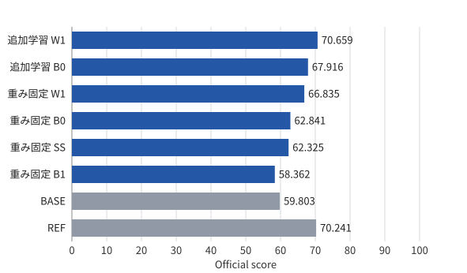
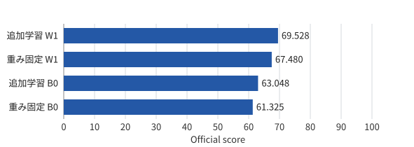

# ASD experiments — 2chマイク録音での異常音検知の実験

DCASE 2026 Task 2（機械の異常音検知）の2chマイク録音を使い、次の2つを確かめる実験コードです。

1. 近接マイクから周囲の音を明示的に引くと、異常音の検知スコアは上がるか（実験1）
2. 特徴抽出モデル BEATs を正常音で追加学習すると、検知スコアはさらに上がるか（実験2）

結果・図・音声は[アプリ一覧](https://kasahart.github.io/asd-experiments/)からブラウザで見られます。インストールやデータ取得は不要です。

## 結果の要点

<!-- summary:start -->


| 観点 | 比較 | Evaluation | Development |
|---|---|---|---|
| ① 明示的なノイズ除去の効果 | B0（固定）→ W1（固定） | +3.99 | +6.16 |
|  | B0（固定）→ SS（固定） | −0.52 | — |
|  | B0（追加学習）→ W1（追加学習） | +2.74 | +6.48 |
| ② BEATs 追加学習の効果 | B0（固定）→ B0（追加学習） | +5.07 | +1.72 |
|  | W1（固定）→ W1（追加学習） | +3.82 | +2.05 |

値は総合スコアの差（処理後 − 基準）で、各条件1回分の結果です。図の破線は公式ベースライン（BASE）と参考システム（REF）で、モデルが異なります。各値は[スコア](#スコア)の表から計算しています。

<!-- summary:end -->

## 目的別の入口

| やりたいこと | 入口 | 必要なもの |
|---|---|---|
| 結果・図・音声をブラウザで見る | [アプリ一覧](https://kasahart.github.io/asd-experiments/) | なし |
| 実験1（入力の比較）を再現する | [CLIの実行](src/asd_min/runner.md#cliを使う)・[入力取得](docs/02-inputs.md) | データ・BEATs重み・公式評価器（CPUでも可） |
| 実験2（BEATs追加学習）を再現する | [実験2の再現手順](reproduction/asd03/README.md) | NVIDIA GPU・データ・BEATs重み・公式評価器 |
| 計算の仕組みを読む | [実装案内](src/asd_min/README.md) | — |
| 利用条件を確かめる | [出典と利用条件](docs/rights.md)・[第三者通知](THIRD_PARTY_NOTICES.md)・[音声の帰属情報](docs/DATA_ATTRIBUTION.md) | — |

## 実験

| 実験 | 比べたもの | データ | アプリ | 固定条件 |
|---|---|---|---|---|
| 実験1：入力の比較 | 近接・遠方マイクと2種類の減算（B0・B1・W1・SS）、BEATs重み固定 | Evaluation | [アプリ](https://kasahart.github.io/asd-experiments/apps/02-b0-b1-w1-ss/) | [固定条件](docs/02-protocol.md) |
| 実験2：BEATs追加学習 | B0とW1を、BEATs重み固定と追加学習（LoRA）で比較 | Development・Evaluation | — | [固定条件](reproduction/asd03/README.md#入力と固定条件) |

記号（B0・W1など）の意味は下の[手法](#手法)、数値の一覧は[スコア](#スコア)にあります。

<!-- experiments:start -->

## 手法

| 手法 | 特徴 | 参考文献 | 使った実験 |
|---|---|---|---|
| B0 | 近接マイク | — | 実験1・実験2 |
| B1 | 遠方マイク | — | 実験1 |
| W1 | 遠方マイクの大きさと位相を合わせて減算（全区間で推定） | [Ozeki技術報告](https://dcase.community/documents/challenge2026/technical_reports/DCASE2026_Ozeki_101_t2.pdf)（同形の減算） | 実験1・実験2 |
| SS | 振幅スペクトル減算 | [Chu・Qian技術報告](https://dcase.community/documents/challenge2026/technical_reports/DCASE2026_Qian_65_t2.pdf)（式1） | 実験1 |

#### 公式ベースライン・参考システム

| 記号 | 役割 | システム | 参考文献 |
|---|---|---|---|
| BASE | 公式ベースライン | DCASE2026_baseline_task2_MSE | — |
| REF | 一部処理の参考元 | Fujimura_MERL_task2_3 | [NA-SSL論文](https://arxiv.org/html/2608.00447v1) |

本実験はBEATs_iter3を使用。REFはNA-BEATsを使うシステムで、RDPなど一部の処理を参考にしています。

## スコア

公式評価器の総合スコア（0–100、高いほど良い）です。データ・特徴抽出の組み合わせごとに1行です。

| データ | 特徴抽出 | B0 | B1 | W1 | SS | 実験 |
|---|---|---|---|---|---|---|
| Evaluation | BEATs_iter3（重み固定） | 62.841 | 58.362 | 66.835 | 62.325 | 実験1・実験2 |
| Evaluation | BEATs_iter3 + LoRA（正常12,000音・25epoch） | 67.916 | — | 70.659 | — | 実験2 |
| Development | BEATs_iter3（重み固定） | 61.325 | — | 67.480 | — | 実験2 |
| Development | BEATs_iter3 + LoRA（正常12,000音・25epoch） | 63.048 | — | 69.528 | — | 実験2 |

数値の正本：[results/02-summary.csv](results/02-summary.csv)・[results/03-beats/summary.csv](results/03-beats/summary.csv)

参考値（Evaluation、本実験とは異なるモデル）：BASE（公式ベースライン）59.803、REF（一部処理の参考元）70.241。出典: [DCASE 2026 Task 2 Results](https://dcase.community/challenge2026/task-first-shot-unsupervised-anomalous-sound-detection-for-machine-condition-monitoring-results) · [システム名・参考値](results/02-challenge-references.json)

### Evaluation

青：本実験（スコア順）／灰：公式・参考値（異なるモデル）。



### Development

青：本実験（スコア順）。



<!-- experiments:end -->

## 実行環境

依存関係は[pyproject.toml](pyproject.toml)で管理します。学習にはPython 3.11を使います。

### Dev Container（推奨）

[.devcontainer](.devcontainer)の設定を使うと、VS Codeの「Dev Containers: Reopen in Container」などで開くだけで、下の手動導入と同じ環境（`.venv`の作成から`pip check`まで）を自動で作ります。`.venv`はコンテナ用のボリュームに置くため、手元の`.venv`とは混ざりません。

| 設定 | 用途 | 必要なもの |
|---|---|---|
| [.devcontainer/devcontainer.json](.devcontainer/devcontainer.json) | 学習・推論（CUDA 12.8版のPyTorch） | NVIDIA GPU、ドライバー、NVIDIA Container Toolkit |
| [.devcontainer/cpu/devcontainer.json](.devcontainer/cpu/devcontainer.json) | テスト・アプリ・CPUでの推論 | Docker |

GPU版はCUDAが使えないと作成時に止まります。その場合はCPU版を選びます。データ・重み・評価器は、リポジトリ内の`inputs/`（Gitの管理外）に置くと、コンテナからも同じパスで使えます。

### 手動で導入する

```bash
python3.11 -m venv .venv
.venv/bin/python -m pip install torch==2.7.1 torchaudio==2.7.1 torchvision==0.22.1 --index-url https://download.pytorch.org/whl/cu128
.venv/bin/python -m pip install -e '.[training,app,visualization,evaluation,test]'
.venv/bin/python reproduction/asd03/runtime.py install
.venv/bin/python -m pip check
```

| extra | 用途 |
|---|---|
| （なし） | 推論だけ（`pip install -e .`） |
| `training` | 実験2の追加学習 |
| `app` | marimoアプリ |
| `visualization` | 図の表示 |
| `evaluation` | 公式評価器の実行 |
| `test` | テスト |

CPU環境では、PyTorchの配布先を`https://download.pytorch.org/whl/cpu`に変えます。Torch・TorchAudio・TorchVisionは[公式PyTorch 2.7.1構成](https://pytorch.org/get-started/previous-versions/)に合わせて同じ配布先から導入します。`runtime.py install`は実験2の学習で使う固定ASDKitを導入します（詳細は[実験2の実行環境](reproduction/asd03/README.md#実行環境)）。

データセット全体・重み・評価器・正解CSVは同梱していません。結果一覧とグラフを更新する手順は[保守手順](docs/maintaining.md)にあります。

## 関連記事

この実験は Zenn の連載で解説しています：[第2回](https://zenn.dev/kasahart/articles/kasahart-20260919-dcase2026-asd-02)（実験1）。
