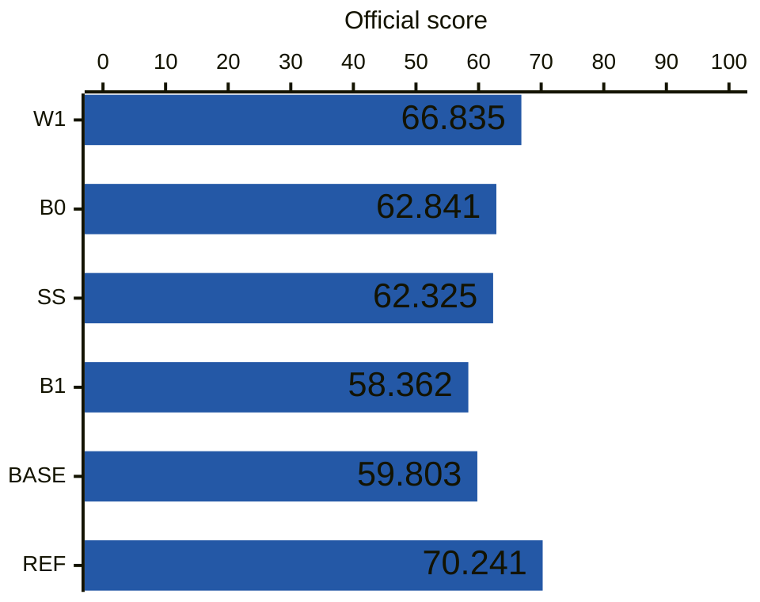
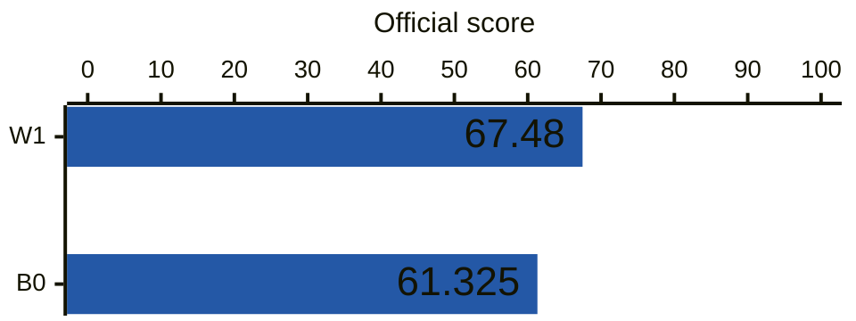
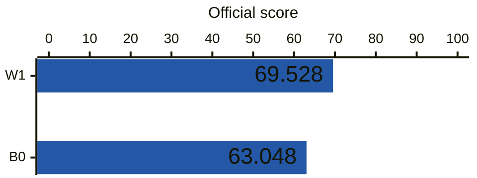
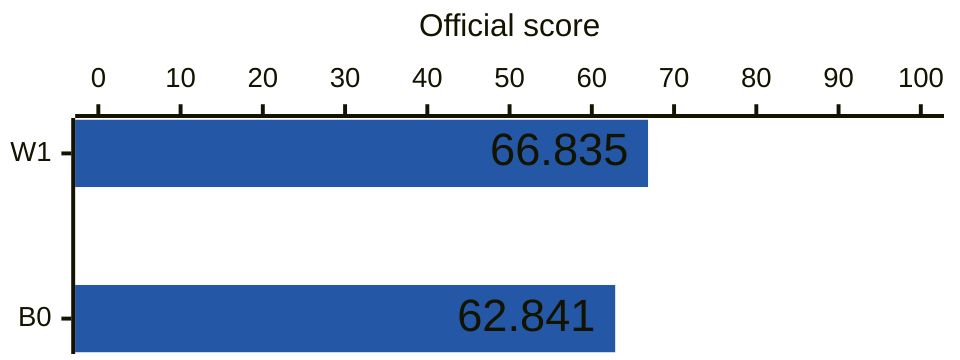
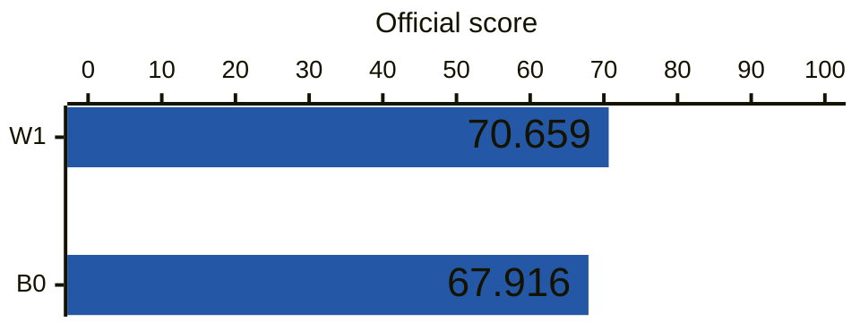

# ASD experiments — Zenn連載の実験コード

Zennの異常音検知（ASD）連載で使った実験コードとmarimoアプリです。DCASE 2026 Task 2の2chマイク録音を使い、周囲の音の除去やBEATsの追加学習で検知スコアがどう変わるかを比べています。結果は[アプリ一覧](https://kasahart.github.io/asd-experiments/)からブラウザで見られます。インストールやデータ取得は不要です。

## 目的別の入口

| やりたいこと | 入口 | 必要なもの |
|---|---|---|
| 結果・図・音声をブラウザで見る | [アプリ一覧](https://kasahart.github.io/asd-experiments/) | なし |
| 第2回の条件比較を再現する | [CLIの実行](src/asd_min/runner.md#cliを使う)・[入力取得](docs/02-inputs.md) | データ・BEATs重み・公式評価器（CPUでも可） |
| 第3回のBEATs追加学習を再現する | [第3回の再現手順](reproduction/asd03/README.md) | NVIDIA GPU・データ・BEATs重み・公式評価器 |
| 計算の仕組みを読む | [実装案内](src/asd_min/README.md) | — |
| 利用条件を確かめる | [出典と利用条件](docs/rights.md)・[第三者通知](THIRD_PARTY_NOTICES.md)・[音声の帰属情報](docs/DATA_ATTRIBUTION.md) | — |

## 連載の回と実験

| 回 | 比べたもの | アプリ | 固定条件 |
|---|---|---|---|
| [第2回](https://zenn.dev/kasahart/articles/kasahart-20260919-dcase2026-asd-02) | 近接・遠方マイクと2種類の減算（B0・B1・W1・SS）、BEATs重み固定 | [第2回のアプリ](https://kasahart.github.io/asd-experiments/apps/02-b0-b1-w1-ss/) | [第2回の固定条件](docs/02-protocol.md) |
| 第3回 | B0とW1を、BEATs重み固定と追加学習（LoRA）で比較 | — | [第3回の固定条件](reproduction/asd03/README.md#入力と固定条件) |

記号（B0・W1など）の意味は下の[手法](#手法)、数値は[スコア](#スコア)にまとめています。

<!-- experiments:start -->

## 手法

### DCASE 2026 Evaluation / BEATs_iter3

[marimoアプリ](apps/02_b0_b1_w1_ss.py)

| 手法 | 特徴 | 特徴抽出モデル | モデルの追加学習 | 参考文献 |
|---|---|---|---|---|
| B0 | 近接マイク | BEATs_iter3 | なし（重み固定） | — |
| B1 | 遠方マイク | BEATs_iter3 | なし（重み固定） | — |
| W1 | 振幅と位相を合わせて減算 | BEATs_iter3 | なし（重み固定） | [Ozeki技術報告](https://dcase.community/documents/challenge2026/technical_reports/DCASE2026_Ozeki_101_t2.pdf)（同形の減算） |
| SS | 振幅スペクトル減算 | BEATs_iter3 | なし（重み固定） | [Chu・Qian技術報告](https://dcase.community/documents/challenge2026/technical_reports/DCASE2026_Qian_65_t2.pdf)（式1） |

#### 公式ベースライン・参考システム

| 記号 | 役割 | システム | 参考文献 |
|---|---|---|---|
| BASE | 公式ベースライン | DCASE2026_baseline_task2_MSE | — |
| REF | 一部処理の参考元 | Fujimura_MERL_task2_3 | [NA-SSL論文](https://arxiv.org/html/2608.00447v1) |

本実験はBEATs_iter3を使用。REFはNA-BEATsを使うシステムで、RDPなど一部の処理を参考にしています。

### DCASE 2026 Development / 固定BEATs（第3回）

| 手法 | 特徴 | 特徴抽出モデル | モデルの追加学習 | 参考文献 |
|---|---|---|---|---|
| B0 | 近接マイク | BEATs_iter3 | なし（重み固定） | — |
| W1 | 全区間の複素線形減算 | BEATs_iter3 | なし（重み固定） | — |

### DCASE 2026 Development / BEATs追加学習（第3回）

| 手法 | 特徴 | 特徴抽出モデル | モデルの追加学習 | 参考文献 |
|---|---|---|---|---|
| B0 | 近接マイク | BEATs_iter3 + LoRA | 正常12,000音・25epoch | — |
| W1 | 全区間の複素線形減算 | BEATs_iter3 + LoRA | 正常12,000音・25epoch | — |

### DCASE 2026 Evaluation / 固定BEATs（第3回）

| 手法 | 特徴 | 特徴抽出モデル | モデルの追加学習 | 参考文献 |
|---|---|---|---|---|
| B0 | 近接マイク | BEATs_iter3 | なし（重み固定） | — |
| W1 | 全区間の複素線形減算 | BEATs_iter3 | なし（重み固定） | — |

### DCASE 2026 Evaluation / BEATs追加学習（第3回）

| 手法 | 特徴 | 特徴抽出モデル | モデルの追加学習 | 参考文献 |
|---|---|---|---|---|
| B0 | 近接マイク | BEATs_iter3 + LoRA | 正常12,000音・25epoch | — |
| W1 | 全区間の複素線形減算 | BEATs_iter3 + LoRA | 正常12,000音・25epoch | — |

## スコア

総合スコアは高いほど良く、本実験の手法はスコア順に並べています。

### DCASE 2026 Evaluation / BEATs_iter3

[固定条件](docs/02-protocol.md) · [入力取得](docs/02-inputs.md) · [総合値](results/02-summary.csv)

青：本実験／灰：公式・参考値（異なるモデル）。



出典: [DCASE 2026 Task 2 Results](https://dcase.community/challenge2026/task-first-shot-unsupervised-anomalous-sound-detection-for-machine-condition-monitoring-results) · [システム名・参考値](results/02-challenge-references.json)

### DCASE 2026 Development / 固定BEATs（第3回）

[固定条件](reproduction/asd03/README.md#入力と固定条件) · [入力取得](reproduction/asd03/README.md#入力の取得と配置) · [総合値](results/03-beats/summary.csv)

青：本実験。



### DCASE 2026 Development / BEATs追加学習（第3回）

[固定条件](reproduction/asd03/README.md#入力と固定条件) · [入力取得](reproduction/asd03/README.md#入力の取得と配置) · [総合値](results/03-beats/summary.csv)

青：本実験。



### DCASE 2026 Evaluation / 固定BEATs（第3回）

[固定条件](reproduction/asd03/README.md#入力と固定条件) · [入力取得](reproduction/asd03/README.md#入力の取得と配置) · [総合値](results/03-beats/summary.csv)

青：本実験。



### DCASE 2026 Evaluation / BEATs追加学習（第3回）

[固定条件](reproduction/asd03/README.md#入力と固定条件) · [入力取得](reproduction/asd03/README.md#入力の取得と配置) · [総合値](results/03-beats/summary.csv)

青：本実験。



<!-- experiments:end -->

## 実行環境

依存関係は[pyproject.toml](pyproject.toml)で管理します。学習にはPython 3.11を使います。

### Dev Container（推奨）

[.devcontainer](.devcontainer)の設定を使うと、VS Codeの「Dev Containers: Reopen in Container」などで開くだけで、下の手動導入と同じ環境（`.venv`の作成から`pip check`まで）を自動で作ります。`.venv`はコンテナ用のボリュームに置くため、手元の`.venv`とは混ざりません。

| 設定 | 用途 | 必要なもの |
|---|---|---|
| [.devcontainer/devcontainer.json](.devcontainer/devcontainer.json) | 学習・推論（CUDA 12.8版のPyTorch） | NVIDIA GPU、ドライバー、NVIDIA Container Toolkit |
| [.devcontainer/cpu/devcontainer.json](.devcontainer/cpu/devcontainer.json) | テスト・アプリ・CPUでの推論 | Docker |

GPU版はCUDAが使えないと作成時に止まります。その場合はCPU版を選びます。データ・重み・評価器は、リポジトリ内の`inputs/`（Gitの管理外）に置くと、コンテナからも同じパスで使えます。

### 手動で導入する

```bash
python3.11 -m venv .venv
.venv/bin/python -m pip install torch==2.7.1 torchaudio==2.7.1 torchvision==0.22.1 --index-url https://download.pytorch.org/whl/cu128
.venv/bin/python -m pip install -e '.[training,app,visualization,evaluation,test]'
.venv/bin/python reproduction/asd03/runtime.py install
.venv/bin/python -m pip check
```

| extra | 用途 |
|---|---|
| （なし） | 推論だけ（`pip install -e .`） |
| `training` | 第3回の追加学習 |
| `app` | marimoアプリ |
| `visualization` | 図の表示 |
| `evaluation` | 公式評価器の実行 |
| `test` | テスト |

CPU環境では、PyTorchの配布先を`https://download.pytorch.org/whl/cpu`に変えます。Torch・TorchAudio・TorchVisionは[公式PyTorch 2.7.1構成](https://pytorch.org/get-started/previous-versions/)に合わせて同じ配布先から導入します。`runtime.py install`は第3回の学習で使う固定ASDKitを導入します（詳細は[第3回の実行環境](reproduction/asd03/README.md#実行環境)）。

データセット全体・重み・評価器・正解CSVは同梱していません。結果一覧とグラフを更新する手順は[保守手順](docs/maintaining.md)にあります。
