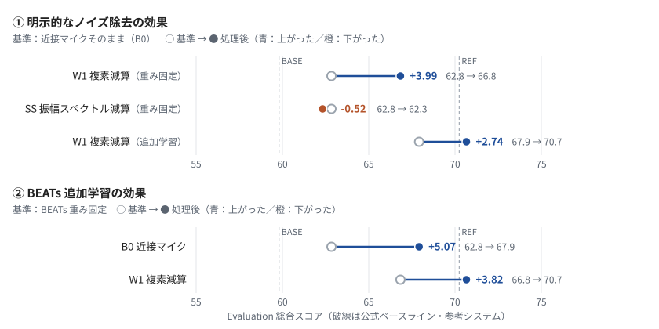

# ASD experiments — 2chマイク録音での異常音検知の実験

DCASE 2026 Task 2（機械の異常音検知）の2chマイク録音を使い、次の問いを確かめる実験コードです。

1. 近接マイクから周囲の音を明示的に引くと、異常音の検知スコアは上がるか（実験1）
2. 特徴抽出モデル BEATs を正常音で追加学習すると、検知スコアはさらに上がるか（実験2）

## 結果の要点

<!-- summary:start -->

- **① 明示的なノイズ除去の効果**（基準：同じBEATs設定で近接マイクそのまま（B0））：W1 複素減算（BEATs 重み固定） +3.99、SS 振幅スペクトル減算（BEATs 重み固定） −0.52、W1 複素減算（BEATs 追加学習） +2.74
- **② BEATs 追加学習の効果**（基準：同じ入力でBEATs重み固定）：B0 近接マイク +5.07、W1 複素減算 +3.82

値は Evaluation の総合スコア（0–100、高いほど良い）の差（処理後 − 基準）で、各条件1回分の結果です。破線は公式ベースライン（BASE）と参考システム（REF）で、モデルが異なります。Developmentの差と全スコアは[結果の詳細](docs/results.md)にあります。

<!-- summary:end -->

## 入口

| やりたいこと | 入口 | 必要なもの |
|---|---|---|
| 結果・図・音声をブラウザで見る | [アプリ一覧](https://kasahart.github.io/asd-experiments/) | なし |
| 手法・全スコア・グラフを読む | [結果の詳細](docs/results.md)・[評価の共通条件](docs/evaluation.md) | — |
| 実験1（入力の比較）を再現する | [固定条件](docs/02-protocol.md)・[CLIの実行](docs/02-protocol.md#実行する) | データ・BEATs重み・公式評価器（CPUでも可） |
| 実験2（BEATs追加学習）を再現する | [固定条件と手順](reproduction/asd03/README.md) | NVIDIA GPU・データ・BEATs重み・公式評価器 |
| 計算の仕組みを読む | [実装案内](src/asd_min/README.md) | — |
| 利用条件を確かめる | [出典と利用条件](docs/rights.md) | — |

## 実行環境

[Dev Container](.devcontainer)で開くと、環境が自動で作られます（GPU版とCPU版）。手動での導入とextraの用途は[実行環境](docs/setup.md)、データ・重み・評価器の取得先は[入力の取得](docs/02-inputs.md)にあります。

## 関連記事

[実験1の解説記事（Zenn連載 第2回）](https://zenn.dev/kasahart/articles/kasahart-20260919-dcase2026-asd-02)
