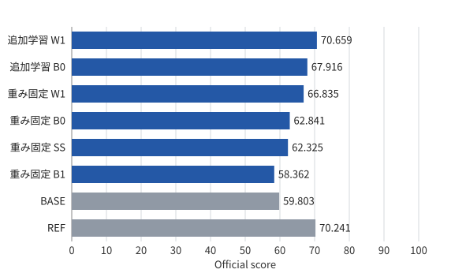
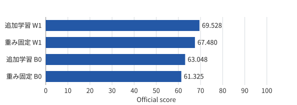

# 結果の詳細

このページは`scripts/update_readme.py`が`configs/readme-methods.csv`・`configs/readme-summary.json`と`results/`のCSVから生成します。手で編集しません（[保守手順](maintaining.md)）。

<!-- experiments:start -->

## 手法

| 手法 | 特徴 | 参考文献 | 使った実験 |
|---|---|---|---|
| B0 | 近接マイク | — | 実験1・実験2 |
| B1 | 遠方マイク | — | 実験1 |
| W1 | 遠方マイクの大きさと位相を合わせて減算（全区間で推定） | [Ozeki技術報告](https://dcase.community/documents/challenge2026/technical_reports/DCASE2026_Ozeki_101_t2.pdf)（同形の減算） | 実験1・実験2 |
| SS | 振幅スペクトル減算 | [Chu・Qian技術報告](https://dcase.community/documents/challenge2026/technical_reports/DCASE2026_Qian_65_t2.pdf)（式1） | 実験1 |

### 公式ベースライン・参考システム

| 記号 | 役割 | システム | Evaluation | 参考文献 |
|---|---|---|---|---|
| BASE | 公式ベースライン | DCASE2026_baseline_task2_MSE | 59.803 | — |
| REF | 一部処理の参考元 | Fujimura_MERL_task2_3 | 70.241 | [NA-SSL論文](https://arxiv.org/html/2608.00447v1) |

本実験はBEATs_iter3を使います。REFはNA-BEATsを使うシステムで、本実験はその一部の処理（RDPなど）を参考にしています。本実験とはモデルが異なるので、同じ条件の順位ではありません。出典: [DCASE 2026 Task 2 Results](https://dcase.community/challenge2026/task-first-shot-unsupervised-anomalous-sound-detection-for-machine-condition-monitoring-results) · [システム名・参考値](../results/02-challenge-references.json)

## 結果の要点

[README](../README.md#結果の要点)の図と同じ比較を、データごとの差で示します。

| 観点 | 比較 | Evaluation | Development |
|---|---|---|---|
| ① 明示的なノイズ除去の効果 | B0（重み固定）→ W1（重み固定） | +3.99 | +6.16 |
|  | B0（重み固定）→ SS（重み固定） | −0.52 | — |
|  | B0（追加学習）→ W1（追加学習） | +2.74 | +6.48 |
| ② BEATs 追加学習の効果 | B0（重み固定）→ B0（追加学習） | +5.07 | +1.72 |
|  | W1（重み固定）→ W1（追加学習） | +3.82 | +2.05 |

差は下の[スコア](#スコア)の丸め前の値から計算しています（表示値の引き算とは最終桁がずれることがあります）。

## スコア

公式評価器の総合スコア（0–100、高いほど良い）です。データ・特徴抽出の組み合わせごとに1行です。

| データ | 特徴抽出 | B0 | B1 | W1 | SS | 実験 |
|---|---|---|---|---|---|---|
| Evaluation | BEATs_iter3（重み固定） | 62.841 | 58.362 | 66.835 | 62.325 | 実験1・実験2 |
| Evaluation | BEATs_iter3 + LoRA（正常12,000音・25epoch） | 67.916 | — | 70.659 | — | 実験2 |
| Development | BEATs_iter3（重み固定） | 61.325 | — | 67.480 | — | 実験2 |
| Development | BEATs_iter3 + LoRA（正常12,000音・25epoch） | 63.048 | — | 69.528 | — | 実験2 |

数値の正本：[results/02-summary.csv](../results/02-summary.csv)・[results/03-beats/summary.csv](../results/03-beats/summary.csv)

### Evaluation

青：本実験（スコア順）／灰：公式・参考値（異なるモデル）。

### Development

青：本実験（スコア順）。

<!-- experiments:end -->
